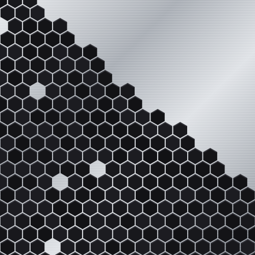
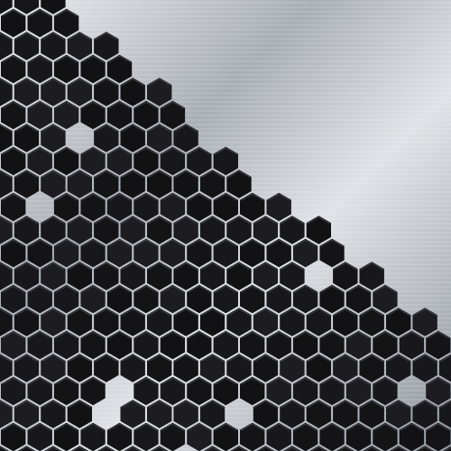
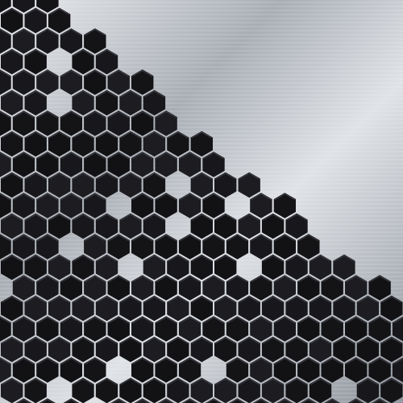
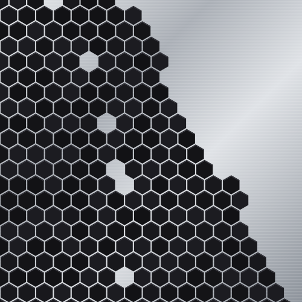
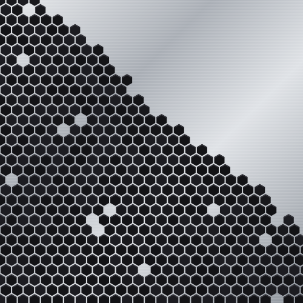
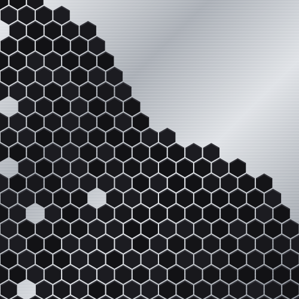
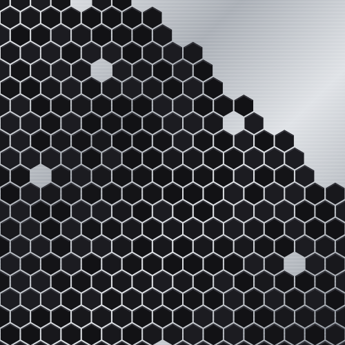

# heatshield-avatar



My GitHub profile picture, drawn by a short Python script: black hexagonal heat-shield tiles, like the ones on SpaceX's Starship, ending in a ragged edge with bare stainless steel beyond it.

## Draw it

```bash
python3 avatar.py                                 # writes avatar.svg (500×500)
rsvg-convert -w 500 avatar.svg -o avatar.png      # optional PNG for uploading
```

No dependencies beyond the Python standard library. With no options the script draws exactly the picture above, and a GitHub Action checks on every push that it still does.

## Make your own

```bash
python3 avatar.py --seed 7 -o mine.svg
```

| Option | Default | What it changes |
|---|---|---|
| `--seed` | 12 | Which tiles go missing and each tile's shade |
| `--tile` | 17 | Tile radius in px, centre to corner |
| `--slope` | 1.15 | How far the tile edge leans; lower is more upright |
| `--offset` | 60 | Where the edge sits; higher means more tiles |
| `--wobble` | 12 | How ragged the edge is; 0 is a straight cut |
| `--missing` | 0.025 | Share of tiles knocked off, from 0 to 1 |
| `--size` | 500 | Width and height in px |
| `-o`, `--out` | avatar.svg | File to write |

## Variations

| | | |
|:---:|:---:|:---:|
| <br>`--seed 7` | <br>`--seed 31 --missing 0.07` | <br>`--slope 0.55 --offset 205` |
| <br>`--tile 11` | <br>`--wobble 32` | <br>`--offset 190` |

## How it works

- **Tiles** are pointy-top hexagons on an offset grid, with every other row shifted half a tile like the real shield. Each one gets a random near-black shade and a faint highlight on its top three edges for depth.
- **The edge:** a tile is only drawn while `x − y × slope ≤ offset + wobble × sin(y / 40)`, so the tiles stop along a leaning, slightly wavy line instead of a straight cut.
- **The steel** is a diagonal four-stop gradient with thin horizontal lines every 5 px for a brushed look.
- **The seed** fixes the random choices, so the same options always give the same picture.

## Ideas

- A web page with a slider for every option and a download button, so anyone can make their own tile avatar.
- An animated version where tiles fall off one by one.

## License

[MIT](LICENSE). Inspired by the heat-shield tiles on SpaceX's Starship; not affiliated with SpaceX.
